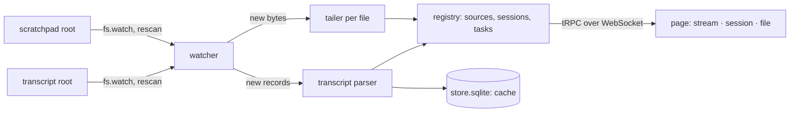

<!-- LLM STEERING: the operator guide for session-tail: what it shows, how to run it in the checkout and
     installed, its settings, and its limits. Authoritative for usage. NOT authoritative for the modules
     and their contracts: docs/engineering.md. Describes what the tool does; no plan references. -->

# session-tail

## Quick start

If you just want to use it right away:

1. Install dependencies in the checkout:

   ```bash
   yarn install
   ```

2. Start the app:

   ```bash
   yarn dev
   ```

   Then open http://127.0.0.1:3459 in your browser.

3. If you want the packaged CLI instead of the dev server:

   ```bash
   yarn package
   ```

   This builds a tarball you can install globally for local use, e.g.:

   ```bash
   npm install -g ./dist/session-tail/session-tail-<version>-<commit>.tgz
   session-tail
   ```

The app watches Claude Code transcripts and scratchpad logs under `~/.claude/projects` and `/private/tmp/claude-*` and renders them as a live session stream. For a full feature-by-feature description, keep reading below.

## Overview

### What this document covers

session-tail is a local web page over the logs of every Claude Code session on this machine. It is for
the person who runs several sessions at once and commissions long work to them (a test tag, a deploy
step, a package build) as background commands: it shows which session is running what, the lines
every session is writing as they are written, the full log of one file, and a filter whose matches
are highlighted. It assumes Claude Code's layout and nothing else: the scratchpad root
`/private/tmp/claude-<uid>` and the transcripts under `~/.claude/projects`. One design choice shapes it:
the tool reads the session transcript as well as the log folder, so a log file is shown with the
description of the command that writes it and the command's exit status, not only its name.

### Where the data lives

| Place | What it holds | Shown as |
|-------|---------------|----------|
| `/private/tmp/claude-<uid>/<project>/<session>/scratchpad/**` | files a session writes while working: tool logs, probes, notes | sources of kind `scratchpad` |
| `/private/tmp/claude-<uid>/<project>/<session>/tasks/<task-id>.output` | the output of a Bash command the session ran; removed by Claude Code after a while | sources of kind `task`, joined to the task |
| `~/.claude/projects/<project>/<session>.jsonl` | the session transcript: title, prompts, every tool call and its result | the session's title, branch, tasks, statuses (never shown as a log) |
| `~/.claude/projects/<project>/<session>/tool-results/*` | large tool outputs Claude Code kept on disk | sources of kind `tool-result`, off by default |
| the transcript's Bash calls and results | every command a session ran in the foreground, with its output | a source of kind `command` named `commands`, one per session |
| the transcript's MCP calls and results | every call a session made to an MCP server (pgedge, the context engine, …) with its input and result | a source of kind `mcp` named `mcp`, one per session |
| `~/.config/session-tail/store.sqlite` (installed) · `./store.sqlite` (checkout) | preferences, highlight rules, the transcript cache | the Preferences page |

`<project>` is the working directory with `/` replaced by `-`; the page labels it by the directory's
base name once a transcript has been read.

### End-to-end flow

The server watches the two roots with one recursive watch each and rescans every 30 seconds. A new or
changed text file is tailed: its new bytes are read and kept (the last 2 MB per file), and sent to
every open page that includes its session. A changed transcript is parsed from where the last read
stopped; a background command's start ("Command running in background with ID …") and its completion
(the task notification with the exit code) become a task, joined to the `tasks/<id>.output` file and
to the log the command names with `--log`. The page keeps a WebSocket open and renders what arrives.



### How it is implemented

The server is one Node process: the collector (watcher, tailers, transcript parser, registry) and a
tRPC server over a WebSocket; in the checkout it runs inside the Vite dev server, installed it is
`server.mjs` behind `bin/session-tail`. The client is a React page with three routes and a
preferences page. **Source:** `src/server/`, `src/routes/`, `src/components/`; the module map is in
`docs/engineering.md`. The rest of this document covers running the tool, the pages, the settings and
the limits.

---

## Running it

### Installed

    npm install -g session-tail-<version>-<commit>.tgz      # Node 22.13 or later; nothing else
    session-tail                                            # http://127.0.0.1:3459
    session-tail --port 3470
    session-tail --version

Without rights on the global prefix: `npm install -g --prefix "$HOME/.local" <tarball>` with
`$HOME/.local/bin` on the PATH.

The server listens on 127.0.0.1. The pages show every session's commands and logs verbatim,
connection strings included; `--host` on another address makes them readable by anyone who reaches
the port, and the start line says so. There is no authentication.

### In the checkout

    yarn install
    yarn dev              # http://127.0.0.1:3459, the sources served by Vite
    yarn probe --list     # the collector on stdout: projects, sessions, tasks
    yarn probe --grep FAIL
    yarn typecheck
    yarn package          # dist/session-tail/session-tail-<version>-<commit>.tgz

## The pages

**Stream** (`/`). One column of lines from every included session, newest at the bottom. Each line
carries the session (a coloured chip with the short id; it opens the session page), the file name (it
opens the focus view; a preference hides the column) and the text; the time the collector read the
line is a column off by default (every backfilled line carries the same one). A thin marker row with the
time, the session and the file opens each burst of output: when the source changes, and when more than
five seconds pass between two lines of one source. A preference turns the markers off. A burst longer than three lines folds to
its first three and an ellipsis row, `… N more lines`, that expands it on click; an expanded burst ends
with `▴ collapse`. The newest burst of a file stays whole, so a live tail keeps showing; a command's or an MCP call's
block arrives complete and folds at once. A preference turns the folding off. The sidebar lists projects and their sessions,
newest first, with the title Claude gave the session (or its first prompt), the branch, the time of the
last activity, and the running tasks with their descriptions; a green dot marks a session active in
the last ten minutes. The checkbox includes the session in the stream; with none checked, every
session is included. Sessions idle for longer than the preference (24 hours) fold behind a count. The `◀` at the top of the
sidebar, the `sessions` button in the top bar, or `b`, hides it; the `▶` strip on the left brings it
back; the choice is kept. The
stream starts with the newest 500 buffered lines, then follows. Scrolling up pauses the auto-scroll; `G` jumps to the end and resumes it, `g` goes
to the start.

**Session** (`/sessions/<project>/<session>`). The session's tasks (status, exit code, start, duration,
description, the command folded, links to the output and the log) and its files (kind, size, time,
the task each belongs to). A file removed from disk is listed as gone and still readable from what was
buffered.

The chip under the title sets the session's
tag: click it, type, Enter (Escape cancels, an empty tag clears); the sidebar's chip does the same. The
tag replaces the short id in every chip: the stream's rows and markers, the follow panel, the sidebar.

**File** (`/file?path=…`). The whole file with line numbers, read in pages from the start, then
followed live. It starts with `← back` (also `Backspace`) and a link to the file's session; the session
page starts with `← back` too. A task's file shows the task's status and description in the header. `wrap` wraps long
lines.

Every session also has a `commands` source: each foreground command the session ran, as a header line
(`>> time · description · ok or ERROR (seconds)`), the command's first line (`$ …`) and its output, as the
transcript records them. It streams, follows and opens like a file; the newest 200 commands are kept
across restarts. And an `mcp` source: each call to an MCP server, as a header line (`>> time · server tool · ok or
ERROR (seconds)`), the call's input as one line of JSON (`$ {…}`) and the result's text; the newest 200
calls are kept across restarts.

**Follow panel** (every page). `f` in a file's view, or `follow` on a session page's file row, adds the
file to the followed set; the lower third of the main pane then shows the live tails of every followed
file merged, each line with the time it arrived and its session chip. A click on a line's text opens
that file in the main pane; a chip in the panel's header opens its file, its `×` unfollows. `p` folds the panel
to its header; its top edge drags to resize it, and the height is kept. The followed set is a preference, so it is there after a reload. `G` (or the
`auto-scroll` button) keeps a view at its end; scrolling up pauses that.

**Filter** (every page). Text or a regular expression (`.*`), case toggle (`Aa`), and a mode:
*highlight* marks the matches in yellow and shows every line; *matching lines only* and *exclude
matching* leave or remove the matching lines (on the server for the stream, in the browser for a file).
`/` focuses the box, `Escape` clears it. A regular expression that does not compile turns the box red
and leaves the previous rule in force.

**Highlight rules** (Preferences). Patterns with a colour, applied in order to every line, on the match
or on the whole line. The defaults: `FAIL`, `ERROR`, `refused` and the like in red; `exit <n>` lines in
red; `PASS`, `OK`, `done` in green; `SKIP`, `WARN` in amber; `== ` step headings in blue; `cpr-run` and
`rmp-run` lines in purple. The command headers of a `commands` source are blue too. Rules are edited and reset on the page and kept in
the store; a default the store lacks is added at start, so disable a default you do not want rather than
delete it.

## Settings

| Setting | Default | Where |
|---------|---------|-------|
| `SESSION_TAIL_ROOTS` | `/private/tmp/claude-<uid>` | environment, `$SESSION_TAIL_ENV_FILE`, `.env` of the working directory (installed); `.env` of the checkout (`yarn dev`) |
| `SESSION_TAIL_TRANSCRIPTS` | `~/.claude/projects` | same |
| `SESSION_TAIL_STORE` | `~/.config/session-tail/store.sqlite` installed · `./store.sqlite` in the checkout | same |
| `SESSION_TAIL_PORT` | 3459 | the checkout's `.env`; installed, `--port` |
| kinds in the stream, backfill lines, lines kept, idle hours, wrap, log font size, interface font size, time column, file column, time markers, collapsed bursts, followed files | see the page | Preferences, in the store |

## What it does not do

- It does not read binary files, `tool-cache/` directories, or `.json` files over 1 MB.
- It does not keep history beyond the last 2 MB of each file in memory and what is on disk; a file
  removed from disk is readable only until the server restarts.
- It does not search across files; the filter applies to what is shown.
- It does not write to any session folder or transcript. The store is its only write.
- It does not authenticate anyone: keep it on the loopback address.
