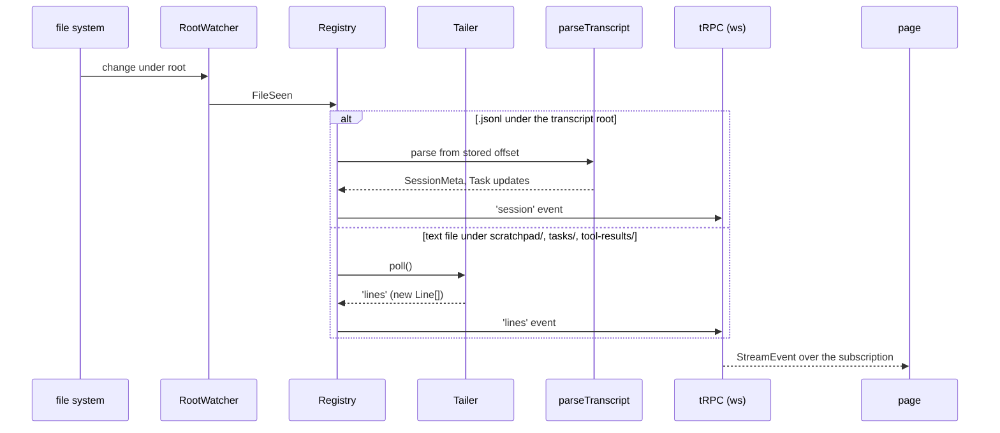

<!-- LLM STEERING: the engineering guide for session-tail: the modules, their contracts, the stores and
     where a change goes. Authoritative for the code's structure. NOT authoritative for usage and
     settings: README.md. Describes what the code does; no plan references. -->

# session-tail — engineering guide

## Overview

### What this document covers

The structure of session-tail for someone changing it: the server modules from the file system to the
tRPC router, the client from the WebSocket to the rows on screen, the sqlite store, and the rules for
adding a source kind, a metadata field, a route, a preference or a highlight rule. It assumes the
reader knows TypeScript, React and the TanStack libraries. The one choice to keep in mind: the server
holds the only model (the registry); the client renders what the subscriptions send and never reads
the file system.

### Where the data lives

| Store | Table / structure | Owner |
|-------|-------------------|-------|
| memory | `Registry.sources: Map<path, Source>`, `Registry.sessions: Map<key, SessionRecord>`, one `Tailer` per source with its `buffer: Line[]` | `src/server/registry.ts`, `src/server/tailer.ts` |
| `store.sqlite` | `preference(key, value, updated_at)` | `src/server/preferences-store.ts` |
| `store.sqlite` | `highlight_rule(id, pattern, regex, case_sensitive, color, scope, enabled, position)` | `src/server/rules-store.ts` |
| `store.sqlite` | `preference` key `followed`: the files the panel tails | `src/hooks/use-follow.tsx` |
| `store.sqlite` | `command_run` (the newest 200 per session) | `src/server/command-store.ts` |
| `store.sqlite` | `session_tag(project, session, tag)` | `src/server/meta-store.ts` |
| `store.sqlite` | `session_meta`, `task_meta`, `transcript_offset(project, session, bytes_read, pending)` | `src/server/meta-store.ts` |
| browser | the stream's rows (capped by the `max_rows` preference), the focus view's lines | `src/hooks/use-stream.ts`, `src/routes/file.tsx` |

### End-to-end flow

A `RootWatcher` (`src/server/watcher.ts`) per root turns file-system events and a 30-second rescan
into `FileSeen` records. The registry (`src/server/registry.ts`) locates each path (`locate()`:
project, session, kind, name), decides whether it is text (`src/server/text-files.ts`), and either
creates a `Tailer` (`src/server/tailer.ts`) for a source or parses a transcript
(`src/server/transcripts.ts`, resumed from the offset in `transcript_offset`). Tailers emit `lines`;
the registry re-emits them with the source id, and keeps `session` events for the summaries. The tRPC
routers (`src/server/trpc/routers/*`) expose the registry's snapshots as queries and its async
generators as subscriptions over `applyWSSHandler` (`src/server/trpc-ws.ts`). The client subscribes
through `@trpc/tanstack-react-query`'s `useSubscription`.

### How it is implemented

Each module owns one concern: `layout.ts` where things are; `text-files.ts` what is text;
`watcher.ts` what changed; `tailer.ts` one file's bytes to lines; `line-reader.ts` (shared with the
client package but server-only in use) the byte-to-line arithmetic; `transcripts.ts` JSONL records to
metadata; `registry.ts` the model and the joins; the stores the sqlite tables; the routers the API.
On the client, `use-stream.ts` and `use-sessions.ts` hold the live data, `log-view.tsx` the
virtualised column, `line-row.tsx` one row, `use-filter.tsx` the filter context and the highlighter,
`follow-panel.tsx` the followed tails over one `stream.all` subscription with `files` named,
`use-follow.tsx` the followed set.
**Source:** `src/server/`, `src/lib/`, `src/routes/`, `src/components/`, `src/hooks/`. The rest of this
document covers each contract and where a change goes.

---

## Server contracts

### Locating a path

`Registry.locate(path)` returns `{ kind, project, session, name }` or null. Under a scratchpad root
the shape is `<root>/<project>/<session>/<area>/…` with `area` = `scratchpad` (any depth) or `tasks`
(one level). Under the transcript root: `<root>/<project>/<session>.jsonl` (kind `transcript`, parsed,
never a source) and `<root>/<project>/<session>/tool-results/<file>`. Anything else is ignored. A new
root layout is a new branch here and a new walk function in `watcher.ts`.

### The tailer

`join(size, fromStart)` sets the first offset: zero for a file created after the server started or
smaller than 64 KB, else 64 KB before the end, moved forward past the partial line; the line number
of that position is counted for files up to 16 MB, else numbering is unknown (`n = 0`). `poll()`
reads from the offset to the current size in 4 MB passes through `readLines`, which consumes only
complete lines; a size smaller than the offset is a truncation (offset and numbering restart, the
buffer is kept); a missing file sets `gone` and keeps the buffer. The buffer holds the last 2 MB by
text length.

### The transcript parser

`parseTranscript(file, project, session, state, meta, known)` reads from `state.offset` in 8 MB
passes. Only lines containing one of the `WANTED` substrings are parsed as JSON. Records read:

| Record | Field(s) | Effect |
|--------|----------|--------|
| `custom-title` | `customTitle` | the title (wins) |
| `ai-title`, `summary` | `aiTitle`, `summary` | the title when none yet |
| `user` | `gitBranch`, `cwd`, `version`, `timestamp` | session metadata; the earliest timestamp is `startedAt` |
| `user` text content | the first text not starting with `<`, not meta, not a sidechain | `firstPrompt` (200 characters) |
| `assistant` `tool_use` | `id`, `name`, `input.command`, `input.description` (or `input.prompt`) | `pending[id]`, the call waiting for its result |
| `user` `tool_result` | "Command running in background with ID: `<id>`. Output is being written to: `<path>`." | a task `running`, joined to `pending[tool_use_id]` |
| `user` `tool_result` of a Bash call or of an `mcp__<server>__<tool>` call that is not a background start | the result text, `is_error`; a `<persisted-output>` pointer is followed to its file | a `CommandRun`, appended to the session's `commands` source |
| `queue-operation` `content` (or a `user` text) holding `<task-notification>` | `task-id`, `tool-use-id`, `output-file`, `status`, `summary` (exit code) | the task's end; a notification without `status` (a Monitor event) is skipped; one with several ids and `status` `stopped` (the summary a resumed session gets) marks the listed running tasks `killed` |

`pending` keeps at most the last 200 entries; the rest are foreground calls whose result never names a
task. `logPathOf(command)` takes `--log <path>` first, else a redirection to a `.log`, `.out` or
`.txt` file; a shell variable the same command assigns is expanded, and a path with an unresolved one is
dropped. The parser state (offset and pending) is stored after every pass; a transcript shorter
than its offset is parsed again from zero.

### A task's end without a notification

The harness writes a trailer as the last line of `tasks/<id>.output`: `[exited with code N]` or
`[killed]`. A task stopped through the harness, or whose session closed before the command returned,
gets no notification in the transcript; the registry reads the trailer from the task source's lines
(`trailer()`), ends the task (`completed` for code 0, `failed` otherwise, `killed`) with the file's
modification time, and keeps the trailer per task id so a task the transcript creates later as
`running` is ended at once. A notification read for the task keeps its own status. A task still
`running` whose output file no longer exists (the harness removes a finished session's `tasks/`
folder) is reported as `unknown` by `summary()`; the stored status is not changed.

### The commands and mcp sources

A session's foreground commands and its MCP calls are two virtual sources, `command:<project>/<session>`
(`commands`) and `mcp:<project>/<session>` (`mcp`), one `VirtualTail` each (the same `LineBuffer` as a
file's tailer, lines numbered as pushed); a run goes to the source of its kind (`kindOf`: the tool's name
starts with `mcp__`). The store keeps the newest 200 of each kind per session (`command_run.tool`). `files.read` on it pages by line index (`pageVirtual`), the page carrying `firstLineNumber`;
`stream.file` yields the held lines then the live ones. The newest 200 commands of a session are
loaded from `command_run` at start and saved as they arrive.

### The registry's joins and summaries

`join(record, source)`: a `task` source's task id is its file name; a `scratchpad` source's task is the
task whose `logPath` resolves to the source's path. `summary(record)` computes `lastActivity` as the
newest of the transcript's mtime, the newest source's mtime and the session's start; `active` is a
running task or activity in the last ten minutes. `projectLabel` is the base name of any `cwd` read
for the project, else the slug's last 40 characters.

### Subscriptions

`stream(filter, signal)`: yields a `source` event per included source, then the newest `backfill`
buffered lines across them in read order as `lines` events, then `backfill-done`, then live events
until the signal aborts. `include`/`exclude` are compiled once per subscription; a change restarts it.
`streamFile(sourceId, afterOffset, signal)`: yields the whole buffer when the tailer is past the
offset the client reached (the client drops lines it already numbered), then live lines.
`sessionChanges(signal)`: the changed summaries, coalesced over 300 ms.

### The API

| Procedure | Kind | Input | Output |
|-----------|------|-------|--------|
| `sessions.list` | query | — | `ProjectSummary[]` |
| `sessions.get` | query | `{ project, session }` | `SessionSummary \| null` |
| `sessions.changes` | subscription | — | `SessionSummary` |
| `sessions.setTag` | mutation | `{ project, session, tag }` (blank clears) | `SessionSummary \| null` |
| `files.read` | query | `{ path, offset, maxBytes }` | `{ lines, nextOffset, size, eof }`; the path must be a listed source |
| `stream.all` | subscription | `StreamFilter` (`files` named overrides sessions and kinds) | `StreamEvent` |
| `stream.file` | subscription | `{ path, afterOffset }` | `Line[]` |
| `preferences.get/where/set/reset` | query, query, mutation, mutation | `Partial<Preferences>` for set | `Preferences` (`where`: the store path) |
| `rules.list/save/delete/reset` | query, mutation, mutation, mutation | `HighlightRule`, `{ id }` | `HighlightRule[]` |

## Client contracts

`useStream(filter, maxRows)` owns the subscription to `stream.all`, batches incoming lines into one
state update per animation frame, caps the rows, and exposes the sources it was told about.
`useSessions()` runs the list query and patches it from `sessions.changes`. `useFilter()` is the
filter context the root provides; `useHighlighter()` compiles the filter and the rules once per change
and returns the function `LineRow` renders text with (`decorate` in `src/lib/filter.ts` cuts a line
into spans: the filter's matches first, then each rule's on the text left free; a line-scoped rule
colours the whole line). `LogView` is the one virtualised column; follow mode is its contract with the
page (`follow`, `onFollow`). `useFollow()` reads and patches the `followed` preference with an optimistic
update; `FollowPanel` subscribes to `stream.all` with `files` set, which overrides sessions and kinds. `withMarkers()` in `src/lib/markers.ts` turns the stream's rows into display rows with a marker before
each run of one source's lines and after a pause of more than `MARKER_GAP_MS` inside a run; `MarkerRow`
renders it. `buildDisplay()` in `src/lib/markers.ts` groups the stream's rows into bursts (`bursts()`) and emits
the display rows: a marker per burst, a burst folded to `COLLAPSED_LINES` with an `ellipsis` row unless
it is a file's newest (`arrivesWhole()` tells a command's or MCP call's block apart) or the user expanded it, a `collapse` row after an expanded one; `FoldRow` renders
both; the stream page keeps the expanded set. `useSessionLabel()` reads the cached session list and gives a session's tag, else its short id;
`TagChip` edits the tag in place through `sessions.setTag`, and the registry's `session` event brings the new
label to every chip.

## Where a change goes

| Change | Place |
|--------|-------|
| a new place to read logs from | `watcher.ts` (a walk), `registry.ts` (`locate`, `attach`), `SourceKind` in `src/lib/types.ts`, the kinds list on the preferences page |
| a new file type to tail | `TEXT_EXTENSIONS` in `text-files.ts` |
| a new session or task field | `transcripts.ts` (the record read), `types.ts`, `meta-store.ts` (column and mapping), the sidebar or session page |
| a new preference | `src/lib/preferences.ts` (the key and its default) and the control on `routes/preferences.tsx`; the store needs no change |
| a new default highlight rule | `DEFAULT_RULES` in `src/lib/rules.ts` (applies to a store with no rules, or after reset) |
| a new page | `src/routes/<name>.tsx`; the route tree regenerates on `yarn dev`; a link in `__root.tsx` |
| the server's bind address or port | `vite.config.ts` (checkout), `serve.ts` (installed) |
| the lines a command renders as | `commandLines()` in `registry.ts` |

## Gates

`node_modules/.bin/tsc --noEmit` in the repository; `yarn probe --list` starts; `yarn package` on a
committed tree passes its self-test.
